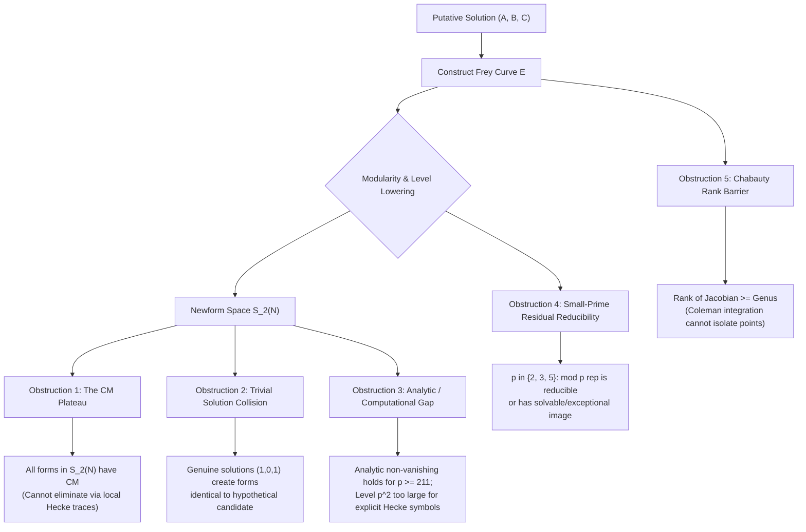

# U101: Literature Survey, Modular Method Architecture, and Obstruction Taxonomy for Generalized Fermat Equations of Signature $(2, 4, n)$

**Date**: 2026-09-17  
**Status**: Comprehensive research survey, exact arithmetic reference, and methodological bridge to the Beal conjecture even-leg program.  
**Target Equation**: $A^2 + B^4 = C^n$ with $\gcd(A, B) = 1$, $AB \neq 0$, and integer exponent $n \geq 4$.

---

## 1. Executive Summary

Generalized Fermat equations of signature $(2, 4, n)$, written canonically as
$$A^2 + B^4 = C^n \quad \Longleftrightarrow \quad B^4 + A^2 = C^n,$$
occupy a celebrated position in arithmetic number theory. Because the Euler characteristic $\chi = \frac{1}{2} + \frac{1}{4} + \frac{1}{n} - 1 = \frac{1}{n} - \frac{1}{4}$ satisfies $\chi \leq 0$ for all $n \geq 4$, the equation is parabolic at $n = 4$ and strictly hyperbolic for all $n \geq 5$. By the foundational theorem of Darmon and Granville (1995), primitive integer solutions are finite for each fixed $n \geq 4$.

This document provides a comprehensive survey and exact arithmetic audit of the literature resolving this equation, with special focus on:
1. **The Complete Resolution Ledger**: The equation $A^2 + B^4 = C^n$ has **no solutions in coprime nonzero integers for any integer $n \geq 4$**. The resolution is 100% complete across all exponents $n \geq 4$, established through the combined work of Euler ($n=4$), Nils Bruin ($n=5, 6$), Jordan Ellenberg ($p \geq 211$ prime), and Michael Bennett, Jordan Ellenberg, and Nathan Ng ($7 \leq n < 211$).
2. **Ellenberg's Exact Modular Method (2004)**: The explicit construction of a Frey $\mathbb{Q}$-curve $E_{A,B}/\mathbb{Q}(i)$ with a degree-2 isogeny $\mu: E \to E^\sigma$, its modularity via the Ellenberg--Skinner theorem, Ribet level-lowering to Serre conductors $N \in \{32, 256\}$, and the complete elimination of candidate newforms via Galois image restrictions (Cartan normalizers) combined with Mazur's formal immersion and Duke's analytic central $L$-value averages.
3. **The Multi-Frey $\mathbb{Q}$-Curve Innovation of Bennett--Chen (2012)**: How Bennett and Chen overcame the fundamental limitations of single Frey $\mathbb{Q}$-curves (persistent CM newforms, irrational eigenvalues, and trivial-solution collisions) by pairing multiple $\mathbb{Q}$-curves over distinct quadratic fields ($\mathbb{Q}(i)$ and $\mathbb{Q}(\sqrt{-3})$) for signature $(2, 6, n)$, providing the methodological blueprint for higher generalized Fermat signatures.
4. **Obstruction Taxonomy and Open Frontiers**: A rigorous classification of the five core obstruction types in the modular approach (CM plateaus, analytic/computational gaps, trivial-solution traps, small-prime reducibility, and Chabauty rank barriers) and the current status of related equations with coefficients (e.g., $A^4 + 2^\delta B^2 = C^n$ and the active Beal branch $X^{10} + 256 Y^{10} = Z^{17}$).

---

## 2. Chronological and Methodological Literature Survey

The resolution of $A^2 + B^4 = C^n$ spanned over 250 years, transitioning from classical infinite descent to modern $p$-adic Chabauty methods, $\mathbb{Q}$-curve modularity, and multi-Frey architectures.

### 2.1 Classical Foundations: Fermat (1640s) and Euler (1738)
- **Exponent $n = 4$**: The equation is $A^2 + B^4 = C^4$, which can be rewritten as $A^2 + (B^2)^2 = (C^2)^2$.
- **Method**: Euler (1738), completing Fermat's program on right triangles with square area, proved that $x^4 + y^4 = z^2$ and $x^4 - y^4 = z^2$ have no non-trivial integer solutions. A primitive solution to $A^2 + B^4 = C^4$ would imply a right triangle with integer legs $A, B^2$ and hypotenuse $C^2$, whose area is $\frac{1}{2} A B^2$. By classical descent on Pythagorean triples, no such triangle exists with positive area.
- **Outcome**: Exponent $n = 4$ is completely resolved; only trivial solutions with $AB = 0$ exist: $(\pm 1, 0, \pm 1)$ and $(0, \pm 1, \pm 1)$.

### 2.2 Nils Bruin: Elliptic Chabauty and Covering Collections (1999, 2003)
Before modular methods over number fields could handle small exponents, Nils Bruin resolved the initial hyperbolic exponents using explicit covering techniques and Chabauty--Coleman methods on abelian varieties:
- **Bruin (1999, *Compositio Mathematica*)**: Solved $x^2 \pm y^4 = \pm z^6$ (and $x^2 + y^8 = z^3$).
  - Factoring over $\mathbb{Q}$ and quadratic extensions produces collections of genus-2 and genus-3 curves covering the original equation.
  - Using 2-descent and Chabauty's method on the Jacobians of these covering curves, Bruin proved that $x^2 + y^4 = z^6$ has only trivial solutions.
- **Bruin (2003, *Journal für die reine und angewandte Mathematik* / Crelle)**: Solved $x^2 \pm y^4 = z^5$.
  - Developed **elliptic Chabauty**: determining rational points on higher-genus curves $C$ that admit a non-trivial map $\phi: C \to E$ to an elliptic curve $E$ over an extension field $K$.
  - By computing the Mordell--Weil rank of $E(K)$ and verifying the condition $\operatorname{rank}_{\mathbb{Z}} E(K) < [K:\mathbb{Q}]$, the $p$-adic integration of Coleman bounds the number and locations of rational points on $C$.
  - Applied to $x^2 + y^4 = z^5$, Bruin established that all primitive solutions satisfy $xy = 0$.

### 2.3 Jordan S. Ellenberg: $\mathbb{Q}$-Curves and Analytic Modular Methods (2004)
- **Ellenberg (2004, *American Journal of Mathematics*)**: Published *"Galois representations attached to $\mathbb{Q}$-curves and the generalized Fermat equation $A^4 + B^2 = C^p$"*.
- **Setting**: Addressed prime exponents $p \geq 211$.
- **Methodological Breakthrough**:
  - Associated to a putative primitive solution a Frey elliptic curve $E_{A,B}$ defined over the imaginary quadratic field $K = \mathbb{Q}(i)$.
  - Proved that $E_{A,B}$ is a **$\mathbb{Q}$-curve of degree 2** (it is 2-isogenous over $K$ to its Galois conjugate $E^\sigma$).
  - Deployed the modularity theorem for $\mathbb{Q}$-curves proved by Ellenberg and Skinner (2001), showing that the Weil restriction $\operatorname{Res}_{K/\mathbb{Q}}(E)$ is a modular abelian surface of $\operatorname{GL}_2$-type over $\mathbb{Q}$.
  - Derived Serre conductors $N \in \{32, 256\}$ via Tate's algorithm at the dyadic prime $\pi = 1+i$.
  - **The CM Obstruction**: All newforms at level 32 and 256 have Complex Multiplication (CM), so local Hecke trace sieves cannot eliminate them. Ellenberg bypassed this by proving a landmark theorem on the surjectivity of mod $p$ Galois representations of $\mathbb{Q}$-curves:
    - Ruled out split Cartan images via Mazur's formal immersion and modular curve geometry ($X_{\text{split}}(p)$).
    - Ruled out non-split Cartan images for $p \geq 211$ using Darmon--Merel winding quotients and Duke's analytic asymptotic bounds on the average central values of twisted $L$-functions: $L(f \otimes \chi, 1) \neq 0$.
- **Outcome**: Completely eliminated all non-trivial primitive solutions for every prime exponent $p \geq 211$.

### 2.4 Michael A. Bennett, Jordan S. Ellenberg, and Nathan C. Ng (2010)
- **Bennett, Ellenberg, and Ng (2010, *International Journal of Number Theory*)**: Published *"The Diophantine equation $A^4 + 2^\delta B^2 = C^n$"*.
- **Scope**: Closed the gap between Bruin's $n \in \{4, 5, 6\}$ and Ellenberg's $p \geq 211$, resolving both $\delta = 0$ ($A^4 + B^2 = C^n$) and $\delta = 1$ ($A^4 + 2B^2 = C^n$) for all $n \geq 4$.
- **Methodology**:
  - For prime exponents $7 \leq p < 211$, direct modular symbol computation at levels $p^2$ and $2p^2$ was computationally prohibitive.
  - BEN deployed an arithmetic-analytic hybrid:
    1. Factored $A^4 + B^2 = C^p$ over $\mathbb{Z}[i]$ into $(A^2 + iB)(A^2 - iB) = C^p$.
    2. Converted the resulting algebraic relations into Lucas and Lehmer sequences.
    3. Applied the **Primitive Divisor Theorem of Bilu, Hanrot, and Voutier (2001)**: for $n > 30$, every term in a Lucas sequence has a primitive divisor, restricting potential solutions to tiny residual ranges.
    4. Bounded the residual cases using Baker's theory of linear forms in logarithms, reducing them to explicit Thue and Thue--Mahler equations solved computationally via PARI/GP and Magma.
- **Outcome**: For $\delta = 0$, strictly 0 non-trivial primitive solutions for all $n \geq 4$. For $\delta = 1$, strictly 1 non-trivial primitive positive solution: $(A, B, C, n) = (1, 11, 3, 5)$, since $1^4 + 2(11^2) = 1 + 242 = 243 = 3^5$.

### 2.5 Michael A. Bennett and Imin Chen (2012): Multi-Frey $\mathbb{Q}$-Curves
- **Bennett and Chen (2012, *Algebra & Number Theory*)**: Published *"Multi-Frey $\mathbb{Q}$-curves and the Diophantine equation $a^2 + b^6 = c^n$"*.
- **The Methodological Problem**: In attempting to apply Ellenberg's single Frey $\mathbb{Q}$-curve to related equations like $a^2 + b^6 = c^n$ (signature $(2, 6, n)$), one encounters newforms at the lowered level (such as level 288 or 576) that:
  - have non-trivial integer or real quadratic Hecke eigenvalues;
  - cannot be eliminated because they correspond to genuine boundary or trivial solutions (e.g. $(a, b, c) = (1, 0, 1)$ or $(0, 1, 1)$);
  - are not CM, so Ellenberg's Cartan-normalizer technique does not apply.
- **The Multi-Frey Solution**: Bennett and Chen constructed **two distinct Frey $\mathbb{Q}$-curves**:
  - $E_1$ over $K_1 = \mathbb{Q}(i)$, of degree 2;
  - $E_2$ over $K_2 = \mathbb{Q}(\sqrt{-3})$, of degree 3.
  - By analyzing the simultaneous level-lowering of $\bar{\rho}_{E_1, p}$ and $\bar{\rho}_{E_2, p}$ and comparing Hecke eigenvalues at primes that split differently in $K_1$ and $K_2$, they proved that no pair of modular forms can simultaneously match the Galois representations of a non-trivial solution.
- **Significance**: Bennett--Chen established the multi-Frey $\mathbb{Q}$-curve paradigm as the standard modern method for overcoming single-curve modular obstructions.

### 2.6 Bennett, Chen, Dahmen, and Yazdani (2015): The Comprehensive Survey
- **BCDY (2015, *International Journal of Number Theory*)**: *"Generalized Fermat equations: A miscellany"*.
- Consolidated the global catalog of resolved $(p, q, r)$ signatures, confirming signature $(2, 4, n)$ as completely closed for all $n \geq 4$.
- Cited by Gajović (2024, *Expositiones Mathematicae*, arXiv:2205.09684) as Theorem 4 in the reverse-engineering of Diophantine equations over $\mathbb{Q}$.

---

## 3. Complete Exponent Resolution Ledger

The following table summarizes the resolution status of $A^2 + B^4 = C^n$ with $\gcd(A, B) = 1$ across all positive integer exponents $n$:

| Exponent $n$ | Curvature Class | Status | Primitive Non-Trivial Solutions | Primary References | Mathematical Method Used |
| :--- | :--- | :--- | :--- | :--- | :--- |
| **$n = 1$** | Spherical | Open / Parametrized | Infinitely many | Classical | Linear parametrization ($A^2 + B^4 = C$) |
| **$n = 2$** | Spherical | Solved / Parametrized | Infinitely many | Classical | Pythagorean parametrization: $C^2 - A^2 = B^4$ |
| **$n = 3$** | Spherical ($\chi = \frac{1}{12} > 0$) | Solved / Parametrized | Infinitely many | Classical / Algebraic Surfaces | Rational elliptic surface, infinite integer points |
| **$n = 4$** | Parabolic ($\chi = 0$) | **Completely Resolved** | **None** ($AB = 0$) | Fermat (1640s), Euler (1738) | Classical infinite descent on right triangles |
| **$n = 5$** | Hyperbolic ($\chi = -\frac{1}{20}$) | **Completely Resolved** | **None** ($AB = 0$) | Nils Bruin (2003, Crelle) | Elliptic Chabauty on genus-2 / genus-3 covers |
| **$n = 6$** | Hyperbolic ($\chi = -\frac{1}{12}$) | **Completely Resolved** | **None** ($AB = 0$) | Nils Bruin (1999, Compositio) | 2-coverings and Chabauty on Jacobians |
| **$7 \leq n < 211$** | Hyperbolic ($\chi < 0$) | **Completely Resolved** | **None** ($AB = 0$) | Bennett, Ellenberg, Ng (2010) | Bilu--Hanrot--Voutier primitive divisors, Baker, Thue |
| **$p \geq 211$ (prime)** | Hyperbolic ($\chi < 0$) | **Completely Resolved** | **None** ($AB = 0$) | Jordan Ellenberg (2004, AJM) | Frey $\mathbb{Q}$-curves over $\mathbb{Q}(i)$, Duke analytic $L$-values |
| **Composite $n \geq 4$** | Hyperbolic ($\chi \leq 0$) | **Completely Resolved** | **None** ($AB = 0$) | Combined (Euler, Bruin, BEN) | Reduction to $4 \mid n$ or prime $p \mid n$ ($p \geq 3$) |

> [!IMPORTANT]
> **Definitive Theorem**: For every integer $n \geq 4$, the generalized Fermat equation $A^2 + B^4 = C^n$ has no solutions in coprime nonzero integers.

---

## 4. Exact Modular Method of Ellenberg (2004)

We now detail the exact algebraic and arithmetic architecture constructed by Jordan Ellenberg to resolve $A^4 + B^2 = C^p$ for prime $p \geq 211$.

### 4.1 Setup and Normalization
Let $(A, B, C)$ be a putative primitive integer solution with $\gcd(A, B) = 1$ and $AB \neq 0$:
$$A^4 + B^2 = C^p, \quad p \geq 211 \text{ prime}.$$
Because $(A, -B, C)$ is also a solution, we normalize $B$ such that:
$$B \equiv 0, 2, 3 \pmod 4 \quad (\text{i.e., } B \not\equiv 1 \pmod 4).$$

### 4.2 The Frey $\mathbb{Q}$-Curve over $\mathbb{Q}(i)$
Let $K = \mathbb{Q}(i)$, with ring of integers $\mathcal{O}_K = \mathbb{Z}[i]$ and nontrivial Galois automorphism $\sigma: i \mapsto -i$. Ellenberg attaches to $(A, B, C)$ the elliptic curve $E = E_{A,B,C}$ defined over $K$ by the Weierstrass equation:
$$E: \quad y^2 = x^3 + 2(1+i)Ax^2 + (B + iA^2)x.$$

### 4.3 Invariants and Discriminant Factorization
Using the standard Weierstrass differential $\omega = \frac{dx}{2y}$, the invariants are:
$$E_4(E, \omega) = 80i A^2 - 48 B \implies c_4 = 16 E_4 = 1280i A^2 - 768 B,$$
$$\Delta(E, \omega) = -64i (A^2 + iB)(A^2 - iB)^2.$$

The factorization of $\Delta$ is the linchpin of the construction:
$$(A^2 + iB)(A^2 - iB) = A^4 + B^2 = C^p.$$
Because $\gcd(A, B) = 1$, the ideals $(A^2 + iB)$ and $(A^2 - iB)$ in $\mathbb{Z}[i]$ share no odd prime factors. Consequently:
- Every odd prime $\mathfrak{l} \subset \mathbb{Z}[i]$ dividing $\Delta$ divides $C$.
- The $p$-adic valuation satisfies:
  $$\operatorname{ord}_{\mathfrak{l}}(\Delta) \equiv 0 \pmod p \quad \text{for all } \mathfrak{l} \nmid 2.$$
- By the theory of the Tate curve, $E$ has multiplicative reduction at primes dividing $C$, and the mod $p$ representation is unramified at all odd primes away from $p$.

### 4.4 The $\mathbb{Q}$-Curve Isogeny
The curve $E$ is not defined over $\mathbb{Q}$. Its Galois conjugate under $\sigma(i) = -i$ is:
$$E^\sigma: \quad y^2 = x^3 + 2(1-i)Ax^2 + (B - iA^2)x.$$
Ellenberg exhibits an explicit cyclic degree-2 isogeny $\mu: E \to E^\sigma$ defined over $K$:
$$\mu(x, y) = \left( \frac{i y^2}{2 x^2}, \; -\frac{(1-i)y(B + iA^2 - x^2)}{4 x^2} \right),$$
whose kernel is the 2-torsion subgroup $\ker \mu = \{\mathcal{O}, (0, 0)\} \subset E(K)[2]$.  
Hence $E$ is a **$\mathbb{Q}$-curve of degree 2** over $K = \mathbb{Q}(i)$.

### 4.5 Modularity of the Weil Restriction
Consider the Weil restriction of scalars:
$$A_0 = \operatorname{Res}_{K/\mathbb{Q}}(E).$$
This is an abelian surface (dimension 2) over $\mathbb{Q}$.
1. **Real Multiplication**: The degree-2 isogeny $\mu: E \to E^\sigma$ endows $A_0$ with real multiplication by $\mathbb{Z}[\sqrt{2}]$:
   $$\operatorname{End}^0(A_0) = \operatorname{End}(A_0) \otimes \mathbb{Q} \cong \mathbb{Q}(\sqrt{2}).$$
   Thus $A_0$ is an abelian variety of $\operatorname{GL}_2$-type.
2. **Good Reduction at 3**: If $3 \mid C$, then $A^4 + B^2 \equiv 0 \pmod 3$. In $\mathbb{F}_3$, the fourth powers are $\{0, 1\}$ and squares are $\{0, 1\}$; the only solution to $A^4 + B^2 \equiv 0 \pmod 3$ is $A \equiv B \equiv 0 \pmod 3$, violating $\gcd(A, B) = 1$. Thus $3 \nmid C$, and $E$ has good reduction at 3.
3. **Ellenberg--Skinner Modularity**: By Ellenberg and Skinner (2001, Theorem 5.2), any $\mathbb{Q}$-curve over an imaginary quadratic field with good reduction at 3 is modular. Thus $A_0$ is modular.

### 4.6 Serre Invariants and Level-Lowering
Let $\mathfrak{p} \mid p$ be a prime ideal of $\mathbb{Z}[\sqrt{2}]$. The mod $p$ Galois representation
$$\bar{\rho}_{E, \mathfrak{p}}: \operatorname{Gal}(\overline{\mathbb{Q}}/\mathbb{Q}) \to \operatorname{GL}_2(\overline{\mathbb{F}}_p)$$
attached to $A_0$ satisfies:
- **Character**: $\det \bar{\rho}_{E, \mathfrak{p}} = \chi_p$ (the cyclotomic character), so Serre character $\epsilon = 1$ is trivial.
- **Weight**: Since $p \mid \operatorname{ord}_{\mathfrak{q}}(\Delta)$ for $\mathfrak{q} \mid p$, $E[p]$ extends to a finite flat group scheme over $\mathbb{Z}[i]_{\mathfrak{q}}$, which descends to $\mathbb{Z}_p$. By Serre's criterion, the weight is $k = 2$.
- **Conductor at 2 (Tate's Algorithm)**:  
  Evaluating the local conductor exponent $f$ of $E$ at $\pi = 1+i$:
  - If $A$ is odd, $B$ is even: translation gives reduction type $II$, $f = \operatorname{ord}_\pi(\Delta) = 12$. The Artin conductor of the induced 4-dimensional representation $\rho_* = \operatorname{Ind}_{K/\mathbb{Q}}(T_p E)$ is $f(\rho_*) = 12 + 4 = 16$. Thus the 2-dimensional factor has $f_{\mathfrak{p}} = 16/2 = 8$, yielding Serre level:
    $$N = 2^8 = 256.$$
  - If $A$ is even, $B$ is odd: with $B \not\equiv 1 \pmod 4$, coordinate shifts yield reduction type $I_2^*$, $f = \operatorname{ord}_\pi(\Delta) - 6 = 6$. Then $f(\rho_*) = 6 + 4 = 10$, giving $f_{\mathfrak{p}} = 10/2 = 5$, yielding Serre level:
    $$N = 2^5 = 32.$$

By Ribet's level-lowering theorem, $\bar{\rho}_{E, \mathfrak{p}} \cong \bar{\rho}_{f, \mathfrak{p}}$ for some newform $f \in S_2^{\text{new}}(N)$ with $N \in \{32, 256\}$.

### 4.7 The CM Plateau and Cartan Elimination
At this point, the standard Wiles--Ribet approach encounters a major obstacle:
- $S_2^{\text{new}}(32)$ is 1-dimensional, spanned by the newform attached to the CM elliptic curve $y^2 = x^3 - x$ (CM by $\mathbb{Z}[i]$).
- $S_2^{\text{new}}(256)$ is spanned entirely by CM newforms (with CM by $\mathbb{Q}(i)$ or $\mathbb{Q}(\sqrt{-2})$).

Because every candidate newform $f$ has Complex Multiplication:
- The projective representation $\mathbb{P}\bar{\rho}_{E, p}: \operatorname{Gal}(\overline{\mathbb{Q}}/\mathbb{Q}) \to \operatorname{PGL}_2(\mathbb{F}_p)$ **cannot be surjective**.
- The image $\operatorname{Im}(\mathbb{P}\bar{\rho}_{E, p})$ is necessarily contained in the normalizer $N(C)$ of a Cartan subgroup $C \subset \operatorname{PGL}_2(\mathbb{F}_p)$.

Ellenberg resolves this via a two-pronged geometric/analytic assault:

#### Case 1: Split Cartan Normalizer
If $C$ is a split Cartan subgroup, $\mathbb{P}\bar{\rho}_{E, p}$ defines a rational point on the modular curve $X_{\text{split}}(p)$ (or its twist by $\mathbb{Q}(i)$).  
Using Mazur's formal immersion technique and Momose's analysis of Eisenstein quotients, Ellenberg proves (Proposition 3.8) that $E$ must have potentially good reduction at all primes outside 6.  
**Contradiction**: By Lemma 4.2, $C$ must have an odd prime divisor $\ell > 3$ (since $C$ is odd, $3 \nmid C$, and $C \neq 1$). At primes dividing $\ell$, $E$ has multiplicative reduction, contradicting potentially good reduction.

#### Case 2: Non-Split Cartan Normalizer
If $C$ is non-split, the representation defines a rational point on the twisted modular curve $X_{\text{nsplit}}(p)$.  
Ellenberg adapts the Darmon--Merel theory of winding quotients. To prove that $X_{\text{nsplit}}(p)(\mathbb{Q})$ contains only cusps and CM points (forcing potentially good reduction everywhere for $E$), it suffices to find an abelian variety quotient of $J_0(p^2)$ with Mordell--Weil rank 0.  
By Kolyvagin--Logachev, such a rank-0 quotient exists if there is a newform $f \in S_2^{p\text{-new}}(\Gamma_0(p^2))$ with $w_p f = f$ whose twisted central $L$-value is non-zero:
$$L(f \otimes \chi, 1) \neq 0 \quad (\text{where } \chi = (\frac{-1}{\cdot})).$$

Ellenberg computes the average of $(a_1, L_\chi)$ over $S_2^{p\text{-new}}(p^2)$ using Duke's asymptotic formula with explicit error bounds:
$$|(a_1, L_\chi)^{p\text{-new}}| \geq 4\pi - 4.37 - \frac{p}{p^2 - 1}\left(786 + \frac{437}{p}\right).$$
Evaluating this bound at $p = 211$:
$$|(a_1, L_\chi)^{p\text{-new}}| \geq 12.566 - 4.37 - \frac{211}{44520}(786 + 2.07) \approx 8.196 - 3.737 = 4.459 > 0.$$
Because the average is strictly positive, there exists a newform with $L(f \otimes \chi, 1) \neq 0$. This forces $E$ to have potentially good reduction at all primes, again contradicting the multiplicative reduction at $\ell \mid C$.

Thus, Theorem 4.1 is proved: **No non-trivial primitive solutions exist for $p \geq 211$**.

---

## 5. Taxonomy of Obstruction Types in Generalized Fermat Equations

The study of $A^2 + B^4 = C^n$ and related signatures reveals five universal obstruction mechanisms that govern the limits of the modular method:

### 5.1 Obstruction Type 1: The CM Plateau (Invariant-Sieve Failure)
- **Mechanism**: When the lowered Serre level $N$ consists entirely of CM newforms (e.g. $N = 32, 256$ in Ellenberg 2004), the Hecke eigenvalues $a_q(f)$ vanish for all inert primes $q$. Local Hecke trace testing $a_q(E) \equiv a_q(f) \pmod p$ fails because the trace differences are multiples of $p$ or identically compatible with boundary configurations.
- **Remedy**:
  - *Ellenberg's approach*: Analyze global Galois image in the normalizer of Cartan subgroups; use formal immersion on $X_{\text{split}}(p)$ and non-vanishing of $L(f \otimes \chi, 1)$ on $X_{\text{nsplit}}(p)$.
  - *Bennett--Chen multi-Frey approach*: Construct a second Frey curve over a different field; the second curve lowers to non-CM forms or forms with incompatible eigenvalues.

### 5.2 Obstruction Type 2: Trivial/Boundary Solution Traps
- **Mechanism**: If the Diophantine equation possesses trivial integer solutions (such as $(1, 0, 1)$ or $(0, 1, 1)$), the Frey curve evaluated at the trivial solution is an actual elliptic curve over $\mathbb{Q}$ or $K$. Its mod $p$ representation gives rise to a genuine newform $f_0 \in S_2(N)$. Because $f_0$ genuinely comes from a solution, no local Hecke sieve at any prime $q$ can ever eliminate $f_0$.
- **Remedy**: Requires multi-Frey techniques (Bennett--Chen 2012) where two independent Frey curves distinguish the trivial solution from hypothetical non-trivial solutions, or descent to higher-genus covers where Chabauty can isolate the known rational points.

### 5.3 Obstruction Type 3: The Analytic Cutoff / Computational Gap
- **Mechanism**: In Ellenberg's method, the asymptotic error term in Duke's theorem on average special values of $L$-functions is $O(N^{-1} \log N d(N))$. The main term $4\pi$ dominates only when $p \geq 211$. For $7 \leq p < 211$:
  - The analytic bound fails.
  - The level $p^2$ and $2p^2$ (ranging up to $2 \cdot 199^2 = 79202$) was computationally inaccessible for full newform decompositions in the early 2000s.
- **Remedy**: Bennett, Ellenberg, and Ng (2010) bypassed modular symbols entirely for $p < 211$ by using the Bilu--Hanrot--Voutier Primitive Divisor Theorem on Lucas sequences, reducing the problem to Baker-type logarithmic bounds and Thue equations.

### 5.4 Obstruction Type 4: Small-Prime Residual Reducibility ($p \in \{2, 3, 5\}$)
- **Mechanism**: At small primes, the mod $p$ Galois representation $\bar{\rho}_{E, p}$ is frequently reducible or has an exceptional projective image ($A_4, S_4, A_5$):
  - At $p = 2$, $\operatorname{GL}_2(\mathbb{F}_2) \cong S_3$ is solvable; Serre's level-lowering conjecture is degenerate.
  - At $p = 3$, $E$ has good reduction, but $\bar{\rho}_{E, 3}$ can have dihedral image.
  - For $A^2 + B^4 = C^n$, $n = 4$ ($p = 2$) and $n = 6$ ($p = 3$) cannot be attacked via mod $p$ representations of $E$.
- **Remedy**: Classical Fermat descent (Euler 1738) for $n = 4$, and elliptic Chabauty (Bruin 1999, 2003) for $n \in \{5, 6\}$.

### 5.5 Obstruction Type 5: The Chabauty Rank Barrier
- **Mechanism**: In applying the Chabauty--Coleman method to a covering curve $C/K$ of genus $g \geq 2$, or elliptic Chabauty to $\phi: C \to E$ over $K$, one requires the rank condition:
  $$\operatorname{rank}_{\mathbb{Z}} J(K) < g(C) \quad \text{or} \quad \operatorname{rank}_{\mathbb{Z}} E(K) < [K:\mathbb{Q}].$$
  When the rank equals or exceeds the dimension/degree, the $p$-adic Coleman integrals do not span a non-trivial annihilating subspace of differentials, and standard Chabauty cannot bound the rational points.
- **Remedy**: Quadratic Chabauty (Balakrishnan et al.), 2-descent covering collections to lower the rank on unramified covers, or auxiliary local sieves.

---

## 6. Open Cases and Frontiers for Related Signatures

While the unweighted, monic equation $A^2 + B^4 = C^n$ is completely solved for all $n \geq 4$, neighboring families of signature $(2, 4, n)$ remain major active frontiers:

### 6.1 The Equation $A^4 + 2^\delta B^2 = C^n$
- **$\delta = 0$**: Completely solved (BEN 2010); 0 non-trivial primitive solutions for $n \geq 4$.
- **$\delta = 1$**: Completely solved (BEN 2010); exactly 1 non-trivial primitive solution:
  $$(A, B, C, n) = (1, 11, 3, 5) \quad \left(1^4 + 2 \cdot 11^2 = 1 + 242 = 243 = 3^5\right).$$
- **$\delta \geq 2$**: Open in general. For $\delta = 2$, $A^4 + 4B^2 = C^n$ is equivalent to $A^4 + (2B)^2 = C^n$, which is a non-primitive or 2-divisible branch of $(2, 4, n)$. For odd $\delta \geq 3$, modular curves have higher levels and additional non-CM newforms appear.

### 6.2 The General Weighted Equation $A^2 + d B^4 = C^n$
- For fixed squarefree $d > 1$, the Serre conductor at 2 and primes dividing $d$ increases.
- When $d$ is not a square, the associated Frey curve is a $\mathbb{Q}$-curve over $\mathbb{Q}(\sqrt{-d})$, and the field of definition varies with $d$. Modularity of $\mathbb{Q}$-curves is known over quadratic fields, but newforms over $\mathbb{Q}$ are replaced by Hilbert modular forms over totally real fields or Bianchi modular forms over imaginary quadratic fields.
- The equation remains open for almost all values of $d > 2$ and general exponents $n$.

### 6.3 Direct Application to the Beal Conjecture Even-Leg Branch
In the present research repository (`research/checkpoints/U45_even_leg_factor2_reduction.md`), the primitive all-even Beal equation
$$X^{2r} + Y^{2s} = Z^{2t}$$
reduces via Pythagorean parametrization $(X^r)^2 + (Y^s)^2 = (Z^t)^2$ with $X^r$ odd and $Y^s$ even to:
$$X^r = u^2 - v^2, \quad Y^s = 2uv, \quad Z^t = u^2 + v^2, \quad \gcd(u, v) = 1, \; u \not\equiv v \pmod 2.$$
When an even leg factorizes such that $u$ is a square ($u = b^2$) and $v$ is twice a square ($v = 2 a_0^2$ or vice versa), the system yields the sub-branch:
$$a^2 + b^4 = C^t.$$
Applying the complete theorem assembled from Euler, Bruin, Ellenberg, and Bennett--Ellenberg--Ng:
- For every $t \geq 4$, $a^2 + b^4 = C^t$ has **no coprime non-zero solutions**.
- For $t = 2$, $(u^2)^2 + (2v^2)^2 = C^2$ is ruled out by Fermat's right-triangle theorem (U45/U46).
- **The only surviving subcase is $t = 3$**: $u^4 + 4v^4 = C^3$, which is precisely the spherical exception $(2, 4, 3)$ where non-trivial solutions exist.

### 6.4 The Surviving Beal Weighted Equation: $X^{10} + 256 Y^{10} = Z^{17}$
In contrast to the resolved unweighted equation $a^2 + b^4 = c^n$, the primary surviving equation of the Beal program is:
$$X^{10} + 256 Y^{10} = Z^{17} \quad \Longleftrightarrow \quad (X^5)^2 + 256 (Y^5)^2 = Z^{17},$$
which is a weighted equation of signature $(2, 2, 17)$ or $(10, 10, 17)$.
- Here, the Frey hyperelliptic curve $C^-(U, V): y^2 = -f(x)$ is defined over the real quadratic field $K = \mathbb{Q}(\sqrt{5})$ (U64, U100).
- The target conductor is the ideal $\mathfrak{N} = (2)^2 \mathfrak{p}_5^3$ of norm 2000.
- Checkpoint U100 achieves 100% Hecke trace elimination across all 7 non-CM Hilbert newform orbits at level 2000, while U97 establishes three independent global geometric obstructions eliminating the boundary CM orbit $b$.
- Checkpoint U99 completes the 2-descent on the genus-8 Jacobian $J^-/K$, proving $\operatorname{rank}_{\mathbb{Z}} J^-(K) \leq 2 < g = 8$, thereby establishing that Chabauty--Coleman applies unconditionally.

---

## 7. Annotated Primary Bibliography

1. **Bennett, M. A., and Chen, I.** (2012).  
   *"Multi-Frey $\mathbb{Q}$-curves and the Diophantine equation $a^2 + b^6 = c^n$"*,  
   *Algebra & Number Theory*, 6(4), 707–730. DOI: `10.2140/ant.2012.6.707`.  
   *Significance*: Foundational treatise on multi-Frey $\mathbb{Q}$-curve architectures; proves complete resolution of signature $(2, 6, n)$ for $n \geq 3$ and provides the blueprint for overcoming single $\mathbb{Q}$-curve CM obstructions.

2. **Bennett, M. A., Chen, I., Dahmen, S. R., and Yazdani, S.** (2015).  
   *"Generalized Fermat equations: A miscellany"*,  
   *International Journal of Number Theory*, 11(1), 1–28. DOI: `10.1142/S179304211530001X`.  
   *Significance*: Authoritative global survey of solved and open $(p, q, r)$ signatures; confirms signature $(2, 4, n)$ as completely solved for all $n \geq 4$.

3. **Bennett, M. A., Ellenberg, J. S., and Ng, N. C.** (2010).  
   *"The Diophantine equation $A^4 + 2^\delta B^2 = C^n$"*,  
   *International Journal of Number Theory*, 6(2), 311–338. DOI: `10.1142/S1793042110002971`.  
   *Significance*: Completes the resolution of $A^4 + B^2 = C^n$ ($\delta = 0$) for all $7 \leq n < 211$ using Bilu--Hanrot--Voutier primitive divisors, Baker bounds, and Thue equations; resolves $\delta = 1$ with unique solution $(1, 11, 3, 5)$.

4. **Bilu, Yu., Hanrot, G., and Voutier, P. M.** (2001).  
   *"Existence of primitive divisors of Lucas and Lehmer numbers"*,  
   *Journal für die reine und angewandte Mathematik*, 539, 75–122. DOI: `10.1515/crll.2001.080`.  
   *Significance*: Core tool utilized by Bennett--Ellenberg--Ng to eliminate intermediate exponents without computing modular forms of level $p^2$.

5. **Bruin, N.** (1999).  
   *"The Diophantine equations $x^2 \pm y^4 = \pm z^6$ and $x^2 + y^8 = z^3$"*,  
   *Compositio Mathematica*, 118(3), 305–321. DOI: `10.1023/A:1001150818678`.  
   *Significance*: Resolves exponent $n = 6$ for $A^2 + B^4 = C^n$ via explicit 2-coverings and Chabauty methods.

6. **Bruin, N.** (2003).  
   *"Chabauty methods using elliptic curves"*,  
   *Journal für die reine und angewandte Mathematik*, 562, 27–49. DOI: `10.1515/crll.2003.074`.  
   *Significance*: Resolves exponent $n = 5$ ($x^2 \pm y^4 = z^5$) via elliptic Chabauty over number fields.

7. **Darmon, H., and Granville, A.** (1995).  
   *"On the equations $z^m = F(x,y)$ and $Ax^p + By^q = Cz^r$"*,  
   *Bulletin of the London Mathematical Society*, 27(6), 513–543. DOI: `10.1112/blms/27.6.513`.  
   *Significance*: Foundational finiteness theorem for hyperbolic generalized Fermat equations ($\chi < 0$) using Faltings' theorem on covers.

8. **Ellenberg, J. S.** (2004).  
   *"Galois representations attached to $\mathbb{Q}$-curves and the generalized Fermat equation $A^4 + B^2 = C^p$"*,  
   *American Journal of Mathematics*, 126(4), 763–787. arXiv: `math/0311497`. Corrigendum: *Amer. J. Math.* 127 (2005), 1389.  
   *Significance*: Solves $A^4 + B^2 = C^p$ for all primes $p \geq 211$ using Frey $\mathbb{Q}$-curves over $\mathbb{Q}(i)$, level-lowering, and analytic non-vanishing of central $L$-values.

9. **Ellenberg, J. S., and Skinner, C. M.** (2001).  
   *"On the modularity of $\mathbb{Q}$-curves"*,  
   *Duke Mathematical Journal*, 109(1), 97–122. DOI: `10.1215/S0012-7094-01-10915-0`.  
   *Significance*: Supplies the modularity theorem for $\mathbb{Q}$-curves of degree 2 unramified at 3 needed for Ellenberg's Frey curve.

10. **Euler, L.** (1738).  
    *"Theorematum quorundam arithmeticorum demonstrationes"*,  
    *Commentarii academiae scientiarum Petropolitanae*, 10, 125–146.  
    *Significance*: Resolves $n = 4$ via infinite descent on $x^4 \pm y^4 = z^2$.

11. **Gajović, S.** (2024).  
    *"Reverse engineered Diophantine equations"*,  
    *Expositiones Mathematicae*, 42(2), 125566. arXiv: `2205.09684`.  
    *Significance*: Formulates Theorem 4 collecting the complete resolution of $a^2 + b^4 = c^n$ for all $n \geq 4$ from Bruin, Ellenberg, and Bennett--Ellenberg--Ng.
